# OTP Bridge — Private Android Notification Forwarding App

A secure, private notification forwarding bridge built specifically for two user-owned Android 14+ phones (**Phone A: Sender** and **Phone B: Receiver**), backed by a lightweight Node.js/Fastify relay server.

---

## 1. System Architecture

```mermaid
flowchart LR
    subgraph PhoneA [Phone A — Sender]
        NLS[Android NotificationListenerService] --> Filter[Explicit Package Allowlist]
        Filter --> OTP[Conservative OTP Detector]
        OTP --> Dedup[Deduplicator Cache]
        Dedup --> ClientA[API Client & Sender Keystore]
    end

    subgraph Server [Backend Relay Server]
        Auth[Fastify & Device Auth]
        Queue[Ephemeral TTL Message Queue]
        WS[WebSocket Manager]
        Auth --> WS
        Auth --> Queue
    end

    subgraph PhoneB [Phone B — Receiver]
        WSClient[Authenticated WebSocket Client]
        UI[Receiver Dashboard]
        Copy[1-Tap Copy to Clipboard]
        WSClient --> UI
        UI --> Copy
    end

    ClientA -- "POST /api/messages (TLS)" --> Auth
    Queue -. "Flush on Reconnect" .-> WS
    WS -- "Real-Time Push (WSS)" --> WSClient
```



---

## 2. Monorepo Structure

```
otp-bridge/
├── mobile/
│   ├── android/                          # Native Android prebuilt project
│   ├── app/                              # Expo Router Screens
│   │   ├── _layout.tsx                   # Material Stack Navigation & Theme
│   │   ├── index.tsx                     # Home Dashboard & Role Picker
│   │   ├── sender.tsx                    # Phone A: Sender Controls & Activity Log
│   │   ├── receiver.tsx                  # Phone B: Real-Time OTP List & 1-Tap Copy
│   │   ├── select-apps.tsx               # Explicit App Allowlist Selector
│   │   ├── pairing.tsx                   # QR Code Generator & Camera Scanner
│   │   └── settings.tsx                  # Server URL & Device Keystore Revocation
│   ├── components/                       # Material-styled Reusable Components
│   │   ├── Card.tsx
│   │   ├── StatusBadge.tsx
│   │   ├── PrimaryButton.tsx
│   │   └── EmptyState.tsx
│   ├── modules/
│   │   └── notification-listener/        # Custom Native Android Module
│   │       ├── android/src/main/java/expo/modules/notificationlistener/
│   │       │   ├── NotificationListenerModule.kt
│   │       │   ├── BridgeNotificationListenerService.kt
│   │       │   └── NotificationEventBus.kt
│   │       ├── expo-module.config.json
│   │       ├── package.json
│   │       └── index.ts
│   ├── plugins/
│   │   └── withNotificationListener.js   # Expo Config Plugin for AndroidManifest
│   ├── services/
│   │   ├── api.ts                        # HTTP API Client
│   │   ├── deduplicator.ts               # Stable Notification Deduplication
│   │   ├── notification-pipeline.ts      # Core Filter, OTP & Forwarding Pipeline
│   │   ├── otp-detector.ts               # Conservative OTP Extraction Engine
│   │   ├── receiver-socket.ts            # Resilient WebSocket Client
│   │   └── storage.ts                    # Keystore Secure Storage
│   ├── tests/                            # Unit & Integration Tests (23 Passing)
│   ├── app.json
│   └── package.json
├── server/
│   ├── src/
│   │   ├── index.ts                      # Fastify Server & WebSocket Hub
│   │   ├── config.ts                     # Zod Environment Validation
│   │   ├── routes/
│   │   │   ├── health.ts                 # Health Check Endpoint
│   │   │   ├── pairing.ts                # Single-Use QR Pairing Lifecycle
│   │   │   ├── devices.ts                # Device Query & Revocation
│   │   │   └── messages.ts               # Message Forwarding with Ephemeral Queue
│   │   ├── security/
│   │   │   ├── sanitize.ts               # Zero-OTP Log Sanitizer
│   │   │   └── token.ts                  # Cryptographic Token Generator (SHA-256)
│   │   ├── services/
│   │   │   ├── device-store.ts           # Device Pairing & Revocation Store
│   │   │   └── message-queue.ts          # Ephemeral In-Memory Queue with Strict TTL
│   │   └── websocket/
│   │       └── ws-server.ts              # Receiver WebSocket Hub & Heartbeats
│   ├── tests/                            # Server Integration Tests (9 Passing)
│   ├── package.json
│   ├── tsconfig.json
│   └── .env.example
├── .gitignore
├── package.json                          # Root monorepo workspace scripts
└── README.md
```

---

## 3. Technology Stack & Prerequisites

### Prerequisites
- **Node.js**: v20.0.0 or newer (tested with v22.14.0)
- **npm**: v10.0.0 or newer
- **Java**: OpenJDK 17 or newer (tested with OpenJDK 25)
- **Android SDK**: Build Tools 34.0.0+, Android 14+ SDK (API 34/35)
- **Hardware**: Two Android devices running Android 14 or newer.

---

## 4. Quick Start & Setup Commands

### 1. Install Dependencies
From the repository root:
```bash
# Install server and mobile dependencies
npm --prefix server install
npm --prefix mobile install
```

### 2. Configure Environment
In the `server/` directory, create a `.env` file based on `.env.example`:
```bash
cp server/.env.example server/.env
```

Default configuration:
```env
PORT=4000
HOST=0.0.0.0
NODE_ENV=development
MAX_PAYLOAD_SIZE_BYTES=16384
RATE_LIMIT_MAX=60
RATE_LIMIT_TIME_WINDOW_MS=60000
PAIRING_TOKEN_TTL_SECONDS=300
MESSAGE_QUEUE_TTL_SECONDS=300
MAX_QUEUED_MESSAGES_PER_RECEIVER=20
```

### 3. Run Automated Tests
Verify all 32 integration & unit tests pass:
```bash
# Run all tests (Server: 9 tests, Mobile: 23 tests)
npm run test

# Or run separately:
npm run test:server
npm run test:mobile
```

### 4. Start the Backend Relay Server Locally
```bash
# From workspace root:
npm run dev:server
```
The server will start at:
- HTTP API: `http://0.0.0.0:4000`
- WebSocket: `ws://0.0.0.0:4000/ws`

---

## 5. Exposing Server to the Internet (HTTPS/WSS)

Because Phone A and Phone B need to communicate over cellular data or different Wi-Fi networks, you should expose the relay server securely:

### Option A: Tailscale (Recommended for Personal Use)
1. Install Tailscale on your server machine and on both Android phones.
2. The server receives a MagicDNS name or static 100.x.y.z IP.
3. Access via `http://<server-tailscale-ip>:4000` securely without port forwarding.

### Option B: Cloudflare Tunnel (Zero Open Ports)
```bash
cloudflared tunnel --url http://localhost:4000
```
Provides an automatic public `https://otp-relay.yourdomain.com` and `wss://otp-relay.yourdomain.com`.

### Option C: Reverse Proxy (Caddy or Nginx with TLS)
```caddy
otp.yourdomain.com {
    reverse_proxy localhost:4000
}
```

### Option D: Deploy to Render (Cloud Hosting with Free HTTPS/WSS)
1. Push your repository to GitHub or GitLab.
2. Sign in to [Render](https://render.com) and click **New +** → **Web Service** (or use **Blueprint** with the included `render.yaml`).
3. Set configuration:
   - **Root Directory**: `server`
   - **Runtime**: `Node`
   - **Build Command**: `npm install --include=dev && npm run build`
   - **Start Command**: `npm start`
   - **Health Check Path**: `/api/health`
4. Render automatically assigns a public HTTPS URL (e.g., `https://otp-bridge-server.onrender.com`) and supports WebSocket (`wss://`) connections out of the box with zero open ports on your local router.


---

## 6. Building the Custom Android Mobile App

Since this app uses custom native Android Kotlin code (`NotificationListenerService`), it cannot run inside standard Expo Go. You must build a custom standalone APK or custom dev build.

### Option 1: Run Local Custom Android Build
Connect your Android phone via USB with USB Debugging enabled:
```bash
cd mobile
npx expo run:android
```

### Option 2: Build Standalone Signed Release APKs
```bash
cd mobile/android
# On Windows PowerShell:
.\gradlew assembleRelease

# On Linux/macOS:
./gradlew assembleRelease
```
The generated APK will be at:
`mobile/android/app/build/outputs/apk/release/app-release.apk`

Install on both phones via ADB:
```bash
adb -s <PHONE_A_SERIAL> install -r app-release.apk
adb -s <PHONE_B_SERIAL> install -r app-release.apk
```

---

## 7. Step-by-Step Installation & Pairing Guide

### Step 1: Set Server URL
1. Open the app on both phones.
2. Tap **Network & Security Settings**.
3. Set your server URL (e.g. `https://otp.yourdomain.com` or `http://192.168.1.100:4000`).
4. Tap **Test Connection** to confirm connectivity.

### Step 2: Configure Phone B (Receiver)
1. On Phone B, tap **Pair New Devices (QR)**.
2. Select the **Display QR (Receiver)** tab.
3. Tap **Create New Pairing Session**. A QR code appears with a 5-minute countdown timer.

### Step 3: Configure Phone A (Sender)
1. On Phone A, tap **Phone A (Sender Mode)**.
2. Android will alert that notification access is required. Tap **Grant Notification Access**.
3. Android's **Special App Access -> Notification Access** screen opens. Toggle **OTP Bridge** to **Allowed**.
4. Return to the app. The permission status will immediately update to **ACTIVE**.
5. Tap **Manage Device Pairing** -> **Scan QR (Sender)**.
6. Grant camera permission and point camera at Phone B's screen.
7. Phone A and Phone B automatically exchange high-entropy credentials. Phone A is bound to Phone B.

### Step 4: Configure Universal Carriers & Target Apps on Phone A
1. On Phone A, tap **Configure Carriers & Applications**.
2. **Universal Message Apps (Carriers)**: Toggle your OTP-receiving messaging apps (e.g. `Google Messages`, `Samsung Messages`, `WhatsApp`, `Telegram`).
3. **Forward All vs Target Filtering**:
   - Toggle **Forward all OTPs from carriers** to forward every genuine OTP received via SMS or WhatsApp.
   - OR uncheck it and select specific **Target Services** (e.g. `Swiggy`, `Uber`, `Amazon`, `Bank`) to only forward OTPs matching those selected applications.
4. Tap **Save Settings**.
> **Smart Matcher Rule**: When OTPs arrive via SMS or WhatsApp, OTP Bridge matches the SMS header (e.g., `AX-SWIGGY`) or message content to your target services, labeling the OTP on Phone B as `Swiggy • via SMS` or `Uber • via WhatsApp`.

### Step 5: Test with Synthetic Notification
1. On Phone A, in the **Sender Dashboard**, tap **Simulate Incoming OTP Notification**.
2. A synthetic notification with a random 6-digit code will enter the native pipeline.
3. Switch to Phone B: the code will appear instantly with a **Copy Code** button!
4. Tap **Copy Code** to copy the code to your clipboard.

---

## 8. Android 14+ Manual Testing Checklist

| Test Scenario | Steps to Execute | Expected Behavior |
| :--- | :--- | :--- |
| **Notification Permission Grant** | Open app, tap "Grant Notification Access", toggle on in Android Settings. | Status switches from "Required" to "ACTIVE" immediately upon app resume. |
| **Notification Permission Revocation** | Go to Android Settings -> Revoke Notification Access for OTP Bridge. | App immediately detects revocation, displays warning banner, and disables processing. |
| **Allowlist Enforcement** | Allow `com.google.android.apps.messaging`. Trigger notification from an unlisted app. | Activity log records `IGNORED_UNLISTED`. Payload is never sent to server. |
| **Screen Off / App Backgrounded** | Lock Phone A screen. Post a synthetic or real notification. | Notification listener service receives event and successfully forwards message. |
| **Battery Optimization** | Enable standard battery saver vs unrestricted battery mode. | For guaranteed 24/7 background delivery, app prompts user to set Battery usage to "Unrestricted". |
| **Phone Reboot** | Reboot Phone A. | Android automatically re-binds `NotificationListenerService` upon boot without user intervention. |
| **Network Interruption** | Put Phone A in Airplane mode, trigger notification, then restore Wi-Fi. | Error logged safely; pipeline resumes forwarding as soon as connectivity returns. |
| **Receiver Offline (TTL Queue)** | Disconnect Phone B Wi-Fi. Trigger notification on Phone A. | Server returns `receiverOffline: true`, stores message in memory TTL queue. Reconnect Phone B: queued OTP is flushed and delivered immediately. |
| **Source App Redacted Content** | App receives notification with hidden/empty text ("New message on lockscreen"). | Pipeline ignores notification as required by spec; no false forward occurs. |
| **False Positive Rejection** | Receive message: "Happy New Year 2026!" or "Order #987654 shipped". | OTP detector rejects numbers lacking verification context. |

---

## 9. Security, Privacy & Threat Model

1. **No SMS Permissions Required**:
   The app uses Android's official `NotificationListenerService` API. It does **not** request `READ_SMS` or `RECEIVE_SMS`, preventing broad inbox access.
2. **Explicit Allowlist Only**:
   The native pipeline enforces package allowlisting before running OTP detection or network dispatch.
3. **Zero Plain-Text OTP Logging**:
   The Fastify server and React Native client use redaction helpers. Server logs record only `[MSG_EVENT] id=... sender=... status=...`, completely omitting verification codes.
4. **Single-Use Replay Protection**:
   Pairing tokens are 256-bit cryptographic secrets that are invalidated immediately upon first use or within 5 minutes.
5. **Ephemeral Storage**:
   OTP notifications are held in ephemeral RAM while active and discarded immediately after delivery or upon the 5-minute TTL expiration. They are never written to a database or disk.
6. **Instant Revocation**:
   Tapping **Unlink** or **Revoke** on either device immediately breaks the device binding on the server and wipes credentials from Android Keystore.
