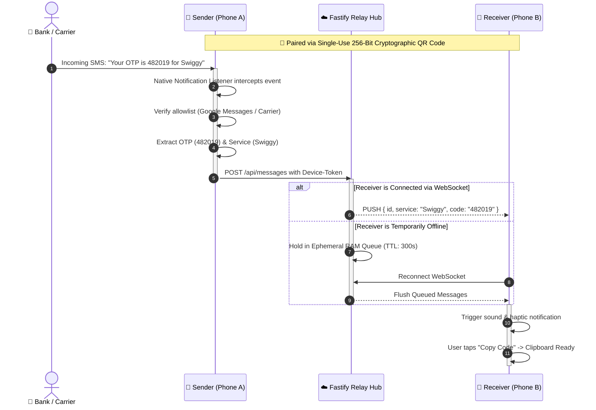

<p align="center">
  
</p>

<h1 align="center">OTP Bridge</h1>

<p align="center">
  <strong>Private, High-Speed Notification & OTP Forwarding Between Android Devices</strong><br>
  <em>Zero SMS permissions required • End-to-end encrypted relay • Real-time WebSocket delivery</em>
</p>

<p align="center">
  
  
  
  
  
</p>

<p align="center">
  <a href="https://render.com/deploy?repo=https://github.com/pratyush4932/otpbridge">
    
  </a>
</p>

---

## 🌟 Overview

**OTP Bridge** is a purpose-built utility designed to automatically, securely, and instantly forward verification codes and OTP notifications between two user-owned Android devices:

* 📱 **Phone A (Sender)**: Monitors incoming SMS / carrier notifications using Android's native `NotificationListenerService` without requesting dangerous `READ_SMS` permissions. Extracts the OTP code and target service name and dispatches it over TLS.
* 🚀 **Relay Server**: Ephemeral, zero-logging Fastify bridge that holds messages strictly in RAM (max 5-minute TTL) and pushes them via real-time WebSockets.
* 📲 **Phone B (Receiver)**: Listens via authenticated WebSocket, displays modern visual cards with carrier tags, and provides **1-Tap Quick Copy** to clipboard with haptic feedback.

---

## 📐 System Architecture

### 🔄 End-to-End Component Flow

```mermaid
flowchart LR
    %% Subgraphs
    subgraph SenderArea ["📱 Phone A (Sender Device)"]
        direction TB
        NLS["🔔 Android Notification Listener"]
        Filter["🛡️ Explicit App Allowlist"]
        Engine["🔍 Smart Carrier & OTP Matcher"]
        Cache["⚡ Deduplication Cache"]
        Client["📤 Secure TLS Dispatcher"]
        
        NLS --> Filter --> Engine --> Cache --> Client
    end

    subgraph ServerArea ["☁️ Fastify Relay Hub"]
        direction TB
        Auth["🔑 Cryptographic Token Auth"]
        Queue["⏱️ Ephemeral TTL RAM Queue"]
        WSHub["📡 Real-Time WebSocket Hub"]
        
        Auth --> Queue
        Auth --> WSHub
        Queue -. "Flush on Reconnect" .-> WSHub
    end

    subgraph ReceiverArea ["📲 Phone B (Receiver Device)"]
        direction TB
        WSClient["⚡ Persistent WebSocket Client"]
        Dashboard["📊 Live OTP Dashboard"]
        CopyBtn["📋 1-Tap Copy with Haptics"]
        
        WSClient --> Dashboard --> CopyBtn
    end

    Client -- "POST /api/messages (TLS)" --> Auth
    WSHub -- "WSS Instant Push" --> WSClient

    %% Custom Styles
    classDef senderStyle fill:#EFF6FF,stroke:#3B82F6,stroke-width:2px,color:#1E3A8A;
    classDef serverStyle fill:#F0FDF4,stroke:#22C55E,stroke-width:2px,color:#14532D;
    classDef receiverStyle fill:#FAF5FF,stroke:#A855F7,stroke-width:2px,color:#581C87;
    
    class NLS,Filter,Engine,Cache,Client senderStyle;
    class Auth,Queue,WSHub serverStyle;
    class WSClient,Dashboard,CopyBtn receiverStyle;
```



---

### ⚡ Real-Time Lifecycle Sequence



---

## ✨ Key Features & Highlights

| Feature | Description | Icon |
| :--- | :--- | :---: |
| **No SMS Permissions** | Uses Android's official `NotificationListenerService` API. Never asks for `READ_SMS` or `RECEIVE_SMS`. | 🛡️ |
| **Smart Carrier Matching** | Distinguishes Indian TRAI SMS headers (e.g. `AX-SWIGGY`, `VK-AMZN`) and labels service origins automatically. | 🎯 |
| **Universal Carrier Support** | Supports Google Messages, Samsung Messages, Truecaller, and optionally Gmail alerts. | 📬 |
| **Zero Plain-Text Logs** | Passwords and OTP codes are redacted from server terminal logs. Only anonymized message IDs are recorded. | 🔒 |
| **Ephemeral RAM Queue** | Codes are never written to disk or database. Messages expire and purge automatically after 5 minutes. | ⏱️ |
| **Instant QR Pairing** | Cryptographic 256-bit token exchange via one-time QR code camera scan. | 📷 |
| **1-Tap Quick Copy** | Fast, intuitive button on Phone B's dashboard that copies the verification code directly to your clipboard. | 📋 |
| **Auto Reconnection** | Resilient exponential backoff keeps WebSocket connected across Wi-Fi and mobile data handovers. | 🔄 |

---

## 📦 Monorepo Structure

```bash
otp_bridge/
├── mobile/                               # 📱 React Native & Android Client
│   ├── android/                          # Native Gradle Android project
│   │   └── app/build/outputs/apk/        # 📍 Compiled APK files (Debug & Release)
│   ├── app/                              # Expo Router Screens & Navigation
│   │   ├── _layout.tsx                   # Unified Header with Rounded Logo
│   │   ├── index.tsx                     # Mode Selector (Sender / Receiver)
│   │   ├── sender.tsx                    # Phone A: Live Activity & Carrier Controls
│   │   ├── receiver.tsx                  # Phone B: Real-Time OTP Stream & 1-Tap Copy
│   │   ├── select-apps.tsx               # Target Apps Allowlist & Filters
│   │   ├── pairing.tsx                   # QR Code Generation & Camera Scanner
│   │   └── settings.tsx                  # Server URL & Device Keystore Revocation
│   ├── assets/                           # Branding assets (otp_logo.png, otpb_icon.png)
│   ├── modules/notification-listener/    # Kotlin Native Android Module
│   └── services/                         # Pipeline, Storage, Carrier & Socket Engine
├── server/                               # ☁️ Fastify Backend Relay
│   ├── src/                              # TypeScript Server Code
│   │   ├── index.ts                      # App bootstrap & WebSocket setup
│   │   ├── config.ts                     # Zod-validated environment config
│   │   ├── routes/                       # REST endpoints (health, pairing, messages)
│   │   └── websocket/                    # Resilient WebSocket connection hub
│   └── tests/                            # Server integration test suite
├── render.yaml                           # 🚀 Render 1-click cloud deployment blueprint
├── RELEASE.md                            # 📖 Comprehensive Android Release & APK Guide
└── package.json                          # Workspace root commands
```

---

## 🚀 Where to Find the APK

After building, your generated APK binaries are located here:

### 📍 Debug APK (Ready for Testing & Sideloading)
```
mobile/android/app/build/outputs/apk/debug/app-debug.apk
```
*Pre-signed with Android's development key. You can install it immediately on any device.*

### 📍 Release APK (Production Distribution)
```
mobile/android/app/build/outputs/apk/release/app-release.apk
```
*(If a custom keystore is not yet configured in `gradle.properties`, the unsigned build will be at `app-release-unsigned.apk`).*

---

## 🛠️ Quick Start & Build Instructions

### 1️⃣ Install Dependencies

From the workspace root directory:
```bash
# Install root, server, and mobile packages
npm install
npm --prefix server install
npm --prefix mobile install
```

### 2️⃣ Run Automated Tests

Execute the full suite of **60 unit & integration tests**:
```bash
npm test
```

---

### 3️⃣ Start the Relay Server Locally

```bash
# From workspace root
npm start

# Or in development watch mode
npm run dev:server
```
The server will start listening at:
- **HTTP REST API**: `http://localhost:4000`
- **WebSocket Endpoint**: `ws://localhost:4000/ws`
- **Health Check**: `http://localhost:4000/api/health`

---

### 4️⃣ Build & Install Mobile App on Android

Connect your Android phone via USB with **USB Debugging** enabled:

```bash
# Check device connection
adb devices

# Build and assemble debug APK
cd mobile/android
.\gradlew assembleDebug

# Install directly to phone with permissions pre-granted
adb -s <DEVICE_ID> install -r -g app/build/outputs/apk/debug/app-debug.apk
```

---

## ☁️ Deploying the Server to Render

You can host the relay server completely free on [Render](https://render.com) with automatic HTTPS/TLS and WebSocket support:

### 🚀 1-Click Instant Deploy

Click the button below to deploy the backend server instantly:

<p align="center">
  <a href="https://render.com/deploy?repo=https://github.com/pratyush4932/otpbridge">
    
  </a>
</p>

Render automatically detects [`render.yaml`](./render.yaml), configures the Node.js runtime, builds the TypeScript code, and establishes your live `https://` REST API and `wss://` WebSocket relay.

---

### Option A: Using Render Blueprints
1. Push this repository to GitHub or GitLab.
2. In the Render Dashboard, click **New +** → **Blueprint**.
3. Select this repository. Render automatically reads `render.yaml` and provisions the Web Service!

### Option B: Manual Web Service Setup
1. In Render Dashboard, click **New +** → **Web Service**.
2. Connect your repository and configure:
   * **Root Directory**: `server`
   * **Runtime**: `Node`
   * **Build Command**: `npm install --include=dev && npm run build`
   * **Start Command**: `npm start`
   * **Health Check Path**: `/api/health`
3. Click **Deploy**. Render will generate a public URL like:
   ```
   https://otp-bridge-server.onrender.com
   ```

---

## 📱 Device Setup & Pairing Walkthrough

### Step 1: Set Server URL
1. Open **OTP Bridge** on both devices.
2. Go to **Settings** (gear icon) and set your Server URL (e.g., `https://otp-bridge-server.onrender.com`).

### Step 2: Display QR on Receiver (Phone B)
1. On **Phone B**, select **Receiver Mode**.
2. Tap **Pair New Device**.
3. A cryptographic QR code with a 5-minute validity countdown will appear.

### Step 3: Grant Permissions & Scan on Sender (Phone A)
1. On **Phone A**, select **Sender Mode**.
2. Tap **Grant Notification Access** → Android Settings will open → Toggle **OTP Bridge** to **Allowed**.
3. *(Recommended)* Set Battery usage to **Unrestricted** to prevent the OS from killing the background listener.
4. Tap **Scan Pairing QR Code** and scan Phone B's screen. Both devices are now securely linked!

---

## 🔒 Security & Privacy Architecture

* **Zero SMS Permissions**: Protects sensitive financial inbox messages by only reading notifications via official Android APIs.
* **Granular Allowlisting**: Only notifications from specified carriers and target applications are ever processed; all other notifications are discarded before extraction.
* **In-Memory Volatility**: OTPs exist in server RAM only and are wiped upon receipt or TTL expiry (300 seconds). No database persistence.
* **Instant Device Revocation**: Either party can tap **Unlink** in Settings to instantly invalidate pairing tokens on both client and server.

---

<p align="center">
  <sub>Built with ❤️ for private, reliable, and secure Android notification forwarding.</sub>
</p>
