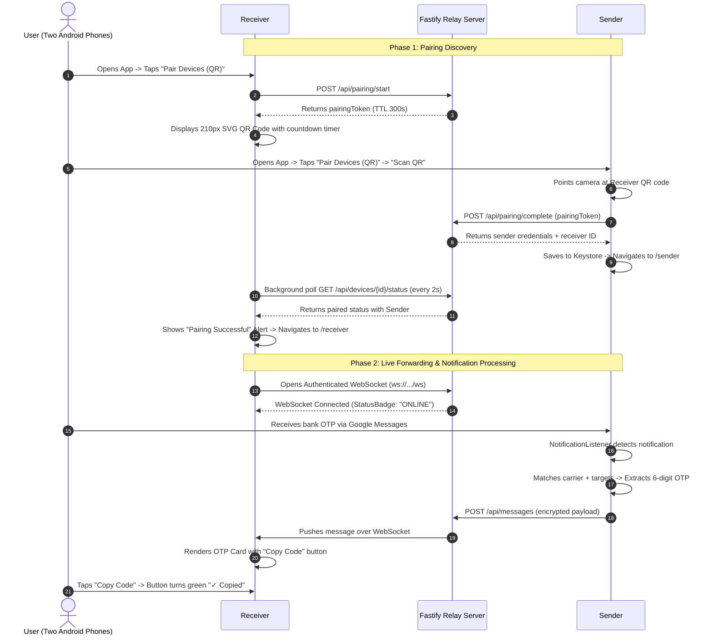

# OTP Bridge — UI Architecture & Visual Specification

> **Target Audience**: AI models, designers, and developers.  
> **Purpose**: A comprehensive, pixel-accurate blueprint detailing the visual hierarchy, layout geometry, typography, color palettes, interactive states, conditional rendering, and exact textual copy across every screen of the OTP Bridge mobile application.

---

## 1. Visual Design Philosophy & Design System

OTP Bridge is built with **React Native** and **Expo Router** targeting **Android 14+**. The visual language is inspired by modern, clean utility software (resembling a cross between Tailwind Slate and Google Material 3). It emphasizes:

- **High Information Density & Legibility**: Essential operational metrics (connection state, pairing identity, background service status) are instantly glanceable.
- **Controlled, Purposeful Color**: The interface uses a neutral Slate background (`#F8FAFC`) with pure white elevated surface cards (`#FFFFFF`). Color is reserved strictly for semantic states: Royal Blue (`#2563EB`) for primary actions/links, Emerald Green (`#16A34A` / `#22C55E`) for active/paired states, Crimson Red (`#DC2626` / `#EF4444`) for critical warnings/danger zones, and Amber/Yellow (`#F59E0B` / `#EAB308`) for degraded/waiting states.
- **Tactile Micro-Feedback**: Instant state changes on button taps, clipboard copies (`✓ Copied`), real-time countdown timers, and animated activity spinners.
- **Privacy Assurance**: Clear visual demarcations indicating that OTPs are never logged to disk and only explicit allowlists are monitored.

---

## 2. Design Tokens & Styling Standards

### 2.1 Color Palette

| Token Name | Hex Code | Semantic Role & Usage |
| :--- | :--- | :--- |
| `Canvas Background` | `#F8FAFC` | Global screen background (Slate 50) |
| `Surface Card` | `#FFFFFF` | Background for elevated content containers |
| `Surface Secondary`| `#F1F5F9` | Neutral pill backgrounds, text inputs, callout containers |
| `Card Border` | `#E2E8F0` | Subtle 1px boundary border around cards |
| `Text Primary` | `#0F172A` / `#1E293B` | High-emphasis headings, titles, active codes |
| `Text Secondary` | `#475569` / `#64748B` | Subheadings, descriptions, metadata labels |
| `Text Muted` | `#94A3B8` | Placeholder text, micro-timestamps, disabled labels |
| `Accent Blue` | `#2563EB` | Primary buttons, active switches, focus outlines, primary accents |
| `Accent Blue Tint` | `#EFF6FF` | Secondary button backgrounds, info badges, app tags |
| `Accent Blue Border`| `#BFDBFE` | Secondary button border, info container borders |
| `Success Green` | `#16A34A` / `#22C55E` | "ACTIVE", "PAIRED", "CONNECTED", "✓ Copied" states |
| `Success Green Tint`| `#DCFCE7` / `#F0FDF4` | Success badge background, permission granted card background |
| `Warning Amber` | `#F59E0B` / `#D97706` | "UNPAIRED", countdown timer warnings, battery optimization notice |
| `Warning Amber Tint`| `#FEF9C3` / `#FEF2F2` | Warning badge background, warning card background |
| `Danger Red` | `#DC2626` / `#EF4444` | "Revoke Credentials", "Unlink", missing permission card |
| `Danger Red Tint` | `#FEE2E2` / `#FEF2F2` | Error badge background, danger card container background |

### 2.2 Typography Hierarchy

- **Display Headings**: Font family `Spline Sans`, `Inter`, or system default sans-serif.
  - Page Titles / Top Headers: `26px`, Weight `800` (Extra Bold), letter-spacing `-0.5px`, color `#0F172A`.
  - Screen Navigation Bar Titles: `18px`, Weight `700` (Bold), color `#0F172A`.
  - Section Headings: `16px`–`18px`, Weight `700` (Bold), color `#1E293B`.
- **Body & Subtitles**:
  - Subtitles / Secondary copy: `13px`–`14px`, Weight `400`–`500`, line-height `18px`–`20px`, color `#64748B`.
  - Field Labels / List Titles: `14px`–`15px`, Weight `600` (Semi-Bold), color `#1E293B` or `#334155`.
  - Microcopy / Metadata: `11px`–`12px`, Weight `400`–`600`, color `#94A3B8` or `#64748B`.
- **Monospace Code Display**:
  - Verification OTP Codes: `24px`, Weight `800` (Bold), letter-spacing `2px`, Font Family `ui-monospace, SFMono-Regular, Menlo, Monaco, Consolas, monospace`, color `#0F172A`.

### 2.3 Global Layout Metrics

- **Screen Padding**: `padding: 16px`, `paddingBottom: 40px` (or `90px` when floating bottom footers exist).
- **Cards**: `borderRadius: 16px`, `padding: 16px`, `marginVertical: 8px`, `borderWidth: 1px`, `borderColor: #E2E8F0`, shadow offset `{ width: 0, height: 1 }`, shadow opacity `0.05`, shadow radius `3px`, elevation `2`.
- **Buttons**: `minHeight: 48px`, `paddingVertical: 14px`, `paddingHorizontal: 20px`, `borderRadius: 12px`.
- **Status Badges**: Pill-shaped `borderRadius: 20px`, `paddingHorizontal: 10px`, `paddingVertical: 4px`, containing a `6x6px` circular dot (`borderRadius: 3px`) on the left and `12px` semi-bold text.

---

## 3. Reusable Core Component Specifications

### 3.1 `Card` (`mobile/components/Card.tsx`)
A raised white container providing elevation and surface grouping.
- **Appearance**: White background (`#FFFFFF`), 16px rounded corners, 1px border (`#E2E8F0`), soft drop shadow.
- **Variations in Code**:
  - *Accent Left-Bordered*: 4px left border (e.g. Royal Blue `#2563EB` for OTP messages; Green `#22C55E` for authorized states; Amber `#F59E0B` for notices; Red `#DC2626` for danger/warnings; Google Red `#EA4335` for Gmail).
  - *Dashed Placeholder*: Dashed border (`#E2E8F0`) with faint gray background for empty carrier states.

### 3.2 `PrimaryButton` (`mobile/components/PrimaryButton.tsx`)
The standard interactive button component.
- **Variants**:
  - `primary`: Background `#2563EB`, text `#FFFFFF`, font-weight `600`, font-size `15px`.
  - `secondary`: Background `#EFF6FF`, border `1px solid #BFDBFE`, text `#1D4ED8`.
  - `outline`: Background `transparent`, border `1.5px solid #CBD5E1`, text `#334155`.
  - `danger`: Background `#DC2626`, text `#FFFFFF`.
  - `disabled`: Background `#E2E8F0`, border `#CBD5E1`, text `#94A3B8`.
- **Loading State**: Replaces label with an `ActivityIndicator` (white for primary/danger, blue `#2563EB` for secondary/outline).

### 3.3 `StatusBadge` (`mobile/components/StatusBadge.tsx`)
Compact pill badge conveying operational state at a glance.
- **Variants**:
  - `success`: Background `#DCFCE7`, text `#166534`, dot `#22C55E`. (e.g., `ACTIVE`, `PAIRED`, `CONNECTED`, `ONLINE`)
  - `warning`: Background `#FEF9C3`, text `#854D0E`, dot `#EAB308`. (e.g., `UNPAIRED`, `NOT PAIRED`, `CONNECTING`, `QUEUED`)
  - `error`: Background `#FEE2E2`, text `#991B1B`, dot `#EF4444`. (e.g., `OFFLINE`, `DISCONNECTED`, `ERROR`)
  - `info`: Background `#DBEAFE`, text `#1E40AF`, dot `#3B82F6`. (e.g., `SENDER`, `RECEIVER`, `X Selected`, `Expires in: ...`)
  - `neutral`: Background `#F1F5F9`, text `#475569`, dot `#94A3B8`. (e.g., `NOT CONFIGURED`, `Checking...`, `DISABLED`)

### 3.4 `EmptyState` (`mobile/components/EmptyState.tsx`)
Centered empty illustration used when lists or logs have no data.
- **Icon Container**: 60x60px circle (`#F1F5F9`), containing a vector icon from `@expo/vector-icons/Ionicons` (28px, `#64748B`), such as `mail-outline`, `shield-checkmark-outline`, `notifications-outline`, or `search-outline`.
- **Title**: `16px`, bold (`#1E293B`), centered.
- **Description**: `13px`, regular (`#64748B`), centered, max-width `260px`, line-height `19px`.

### 3.5 `AppIcon` (`mobile/components/AppIcon.tsx`)
Standardized application launcher icon renderer supporting native Base64 drawables.
- **Icon Rendering**: Accepts `icon` (Base64 data URI `data:image/png;base64,...`), `appName`, and `size` (default `40px` or `44px`). Renders using `<Image>` with smooth rounded corners (`borderRadius: size * 0.22`).
- **Graceful Fallback**: If no icon URI is present or image loading fails, renders an elegant tinted monogram box (`#EFF6FF`, border `#BFDBFE`) with the first letter of the application in bold blue (`#1D4ED8`).


### 3.6 `SessionTimeline` (`mobile/components/SessionTimeline.tsx`)
A vertical, event-driven timeline component representing chronological connection and pairing events.
- **Node Indicators**: 24x24px rounded badge node with an event-specific vector icon (e.g. `qr-code`, `checkmark-circle`, `wifi`, `cloud-offline`, `link`, `alert-circle`). Color-coded based on status: Emerald (`#16A34A`), Amber (`#D97706`), Red (`#DC2626`), or Blue (`#2563EB`).
- **Connecting Line**: Vertical 2px line (`#E2E8F0`) bridging sequential timeline entries.
- **Content Row**:
  - Title: `14px`, Semi-bold (`#0F172A`).
  - Details / Context: `12px`, Regular (`#64748B`), optional secondary status.
  - Local Timestamp: `11px`, Medium (`#94A3B8`), rendered in device's local timezone.
- **Empty State**: Renders an inline notice when no events have yet been recorded.

---

## 4. Navigation Architecture & Unified Header Standard

The navigation stack is managed by Expo Router inside `mobile/app/_layout.tsx`:
- **Exactly One Top-Level Header**: Every screen displays at most one top-level navigation header with the title **`OTP Bridge`**.
- **No Duplicate Screen Headers**: Screen context is conveyed exclusively through compact in-content section headers (e.g., `Sender Mode`, `Receiver Mode`), not duplicate header banners or duplicate page titles.
- **Status Bar**: `StatusBar style="dark"` (black icons/time on top with edge-to-edge Android support).
- **Navigation Bar Background**: Pure White (`#FFFFFF`).
- **Header Title**: Slate 900 (`#0F172A`), `fontWeight: '700'`, `fontSize: 18`, strictly named `OTP Bridge`.
- **Header Shadow**: Explicitly hidden (`headerShadowVisible: false`) to blend seamlessly with the content canvas.
- **Native Android Back Navigation**: Automatically enabled on secondary screens with proper back button routing.

```
                    ┌─────────────────────────┐
                    │       HomeScreen        │
                    │         (/)             │
                    └────────────┬────────────┘
         ┌───────────────────────┼───────────────────────┐
         ▼                       ▼                       ▼
┌──────────────────┐    ┌──────────────────┐    ┌──────────────────┐
│   SenderScreen   │    │  ReceiverScreen  │    │  PairingScreen   │
│    (/sender)     │    │   (/receiver)    │    │   (/pairing)     │
└────────┬─────────┘    └──────────────────┘    └──────────────────┘
         │                                               │
         ▼                                               ▼
┌──────────────────┐                            ┌──────────────────┐
│ SelectAppsScreen │                            │  SettingsScreen  │
│ (/select-apps)   │                            │   (/settings)    │
└──────────────────┘                            └──────────────────┘
```

---

## 5. Detailed Screen-by-Screen UI Specification

---

### SCREEN 1: Home Dashboard (`mobile/app/index.tsx`)
- **Route**: `/`
- **Nav Header Title**: `OTP Bridge`
- **Target Role**: Initial landing screen on both Sender and Receiver devices.
- **Features**: Live server health indicator, device pairing status summary, device mode routing buttons, privacy guarantee callout, pull-to-refresh, automatic reactive reloads on screen focus, history changes, and periodic background poll.

#### ASCII Wireframe
```text
+-------------------------------------------------------+
| OTP Bridge                                            | [Dark Status Bar]
+-------------------------------------------------------+
| [Auto-reloads on focus, history change, and polling]  |
|                                                       |
| OTP Bridge                                            | <- 26px Bold Slate-900
| Private, encrypted notification forwarding between    | <- 14px Slate-500
| Android 14+ devices.                                  |
|                                                       |
| +---------------------------------------------------+ |
| | Connection Overview                               | | <- Card
| |                                                   | |
| | Relay Server                   [● Online        ] | | <- StatusBadge
| | ------------------------------------------------- | |
| | Device Role                    Sender / Receiver  | | <- Role text
| | ------------------------------------------------- | |
| | Pairing State                  [● PAIRED        ] | | <- StatusBadge
| | ------------------------------------------------- | |
| | Allowed Sources                [● 4 Selected    ] | | <- Conditional (Sender)
| +---------------------------------------------------+ |
|                                                       |
| +---------------------------------------------------+ |
| | Active Session / Choose Mode                      | | <- Card
| | Choose how this device should operate in your     | |
| | personal bridge:                                  | |
| |                                                   | |
| | [ Set Up Sender                                 ] | | <- Primary Blue Btn
| |                                                   | |
| | [ Set Up Receiver                               ] | | <- Secondary Light-Blue
| |                                                   | |
| | [ Pair Devices (QR)                             ] | | <- Outline Btn
| +---------------------------------------------------+ |
|                                                       |
| [ Network & Security Settings                       ] | <- Outline Btn (Full width)
|                                                       |
| +---------------------------------------------------+ |
| | ▍ Security & Privacy Guarantee                    | | <- Callout (4px Blue Left Bar)
| | • Only notifications from explicitly allowlisted  | |
| |   packages are processed.                         | |
| | • No SMS inbox permissions requested.             | |
| | • Plain OTP values and message contents are       | |
| |   never persisted or logged to disk.              | |
| +---------------------------------------------------+ |
+-------------------------------------------------------+
```

#### Element Inventory & States
1. **Header Info Banner**:
   - Title: `OTP Bridge` (Font size: 26px, weight: 800, color: `#0F172A`).
   - Subtitle: `Private, encrypted notification forwarding between Android 14+ devices.` (Font size: 14px, color: `#64748B`).
2. **Connection Overview Card**:
   - Title: `Connection Overview` (16px, 700 bold).
   - Row 1: `Relay Server` label + `StatusBadge`:
     - If healthcheck in progress: `Checking...` (variant: `neutral`).
     - If reachable: `Online` (variant: `success`).
     - If unreachable: `Offline` (variant: `error`).
   - Row 2: `Device Role` label:
     - `Sender`, `Receiver`, or `Not Configured`.
   - Row 3: `Pairing State` label + `StatusBadge`:
     - If paired (`deviceId` and `pairedWithId` present): `PAIRED` (variant: `success`).
     - If not paired: `UNPAIRED` (variant: `warning`).
   - Row 4 (Conditional — rendered only if role is `sender`):
     - `Allowed Sources` label: `{allowlistCount} apps` or `All carriers`.
3. **Primary Action / Choose Mode Card**:
   - Title: `Choose Mode` or `Active Session` (16px, 700 bold).
   - Description: Context-aware guidance text.
   - Button 1: `Set Up Sender` (if unconfigured) or `Open Sender Dashboard` (variant: `primary`, bg `#2563EB`).
   - Button 2: `Set Up Receiver` (if unconfigured) or `Open Receiver Dashboard` (variant: `secondary`, bg `#EFF6FF`).
   - Button 3: `Pair Devices (QR)` (variant: `outline`).
4. **Settings Footer Action**:
   - Button: `Network & Security Settings` (variant: `outline`) -> navigates to `/settings`.
5. **Security & Privacy Guarantee Notice Box**:
   - Container: Background `#F1F5F9`, border radius 12px, 4px solid left border `#2563EB`, padding 14px.
   - Title: `Security & Privacy Guarantee` (13px, 700 bold, `#1E293B`).
   - 3 bullet points in 12px `#475569`.

---

### SCREEN 2: Sender Mode (`mobile/app/sender.tsx`)
- **Route**: `/sender`
- **Nav Header Title**: `OTP Bridge`
- **Target Role**: Primary phone receiving SMS/Notifications from banks and services (`Sender`).
- **Features**: Android Notification Listener permission alert/status, live toggle switch for forwarding, linked receiver status, links to configure carriers/target apps, session history shortcut, redacted real-time activity log feed, Android 14 battery optimization alert, automatic focus and background state reload.

#### ASCII Wireframe
```text
+-------------------------------------------------------+
| < OTP Bridge                                          |
+-------------------------------------------------------+
| Sender Mode                      Session History →    |
|                                                       |
| [IF PERMISSION MISSING]:                              |
| +---------------------------------------------------+ |
| | Notification Access Required                      | | <- Red Card (#FEF2F2)
| | Android requires explicit Notification Listener   | |
| | permission so Sender can detect OTPs.             | |
| | [ Grant Notification Access                     ] | | <- Red Primary Button
| +---------------------------------------------------+ |
|                                                       |
| +---------------------------------------------------+ |
| | Forwarding Active                          [ ON ] | | <- Interactive Switch
| | Actively forwarding OTPs to Receiver              | |
| | ------------------------------------------------- | |
| | Paired Receiver                 [● CONNECTED    ] | | <- StatusBadge
| | Active Carriers                      3 active     | |
| | Target Services                    5 selected     | |
| |                                                   | |
| | [ Configure Carriers & Applications             ] | | <- Secondary Button
| +---------------------------------------------------+ |
|                                                       |
| +---------------------------------------------------+ |
| | Recent Activity                   Zero • Redacted | | <- Card
| |                                                   | |
| | Swiggy • Google Messages           [● FORWARDED ] | | <- Activity Item 1
| | Code: 48**** • forwarded to Receiver              | |
| | 12:45:02 PM                                       | |
| | ------------------------------------------------- | |
| | com.twitter.android                [● IGNORED   ] | | <- Activity Item 2
| | Message: "New follower alert" • ignored: unlisted | |
| | 12:42:15 PM                                       | |
| +---------------------------------------------------+ |
|                                                       |
| +---------------------------------------------------+ |
| | ▍ Android 14+ Battery Notice                      | | <- Amber Callout
| | To ensure background forwarding while screen is   | |
| | off, set OTP Bridge's battery usage to            | |
| | "Unrestricted" in Android App Settings.           | |
| +---------------------------------------------------+ |
+-------------------------------------------------------+
```

#### Element Inventory & States
1. **Permission Card (Conditional)**:
   - *State A: Not Granted*:
     - Container: Background `#FEF2F2`, border `#FECACA`.
     - Heading: `Notification Access Required` (16px, 700 bold, `#991B1B`).
     - Description: Explains requirement.
     - Button: `Grant Notification Access` (variant `primary`, red background `#DC2626`). Tapping opens Android OS `Special app access -> Notification access`.
2. **Forwarding Controls Card**:
   - Heading: `Forwarding Active` + description + Android native `Switch` (`#2563EB` thumb when on, `#94A3B8` when off).
   - Horizontal separator line (`#F1F5F9`).
   - Row 1: `Paired Receiver` label + `StatusBadge` (`CONNECTED` [success] or `NOT PAIRED` [warning]).
   - Row 2: `Active Carriers` label + text `{carrierCount} active`.
   - Row 3: `Target Services` label + text `{targetCount} selected`.
   - Button: `Configure Carriers & Applications` (variant: `secondary`, full-width) -> routes to `/select-apps`.
3. **Recent Activity (Redacted) Feed Card**:
   - Heading: `Recent Activity` + `Zero-storage • Redacted`.
   - Empty State: If empty, renders `EmptyState` component with envelope icon and `No activity recorded`.
   - Item Row (up to 15 items):
     - Line 1: Service Name or Package Name + `StatusBadge` (`FORWARDED` [green], `QUEUED` [yellow], or `IGNORED_UNLISTED` / `IGNORED_NO_OTP` [neutral]).
     - Line 2: Redacted code text (e.g. `Code: 59**** • forwarded to Receiver` or `Message: "Your order shipped" • ignored: no otp pattern`).
     - Line 3: Timestamp (e.g. `12:45:02 PM`).
4. **Battery Optimization Notice Box**:
   - Amber callout (`#F1F5F9`, 4px left border `#F59E0B`, title `#92400E`, text `#78350F`). Instructs user to set battery to "Unrestricted" for screen-off delivery.

---

### SCREEN 3: Receiver Mode (`mobile/app/receiver.tsx`)
- **Route**: `/receiver`
- **Nav Header Title**: `OTP Bridge`
- **Target Role**: Secondary phone or device receiving forwarded OTPs (`Receiver`).
- **Features**: Live WebSocket connection badge, paired Sender status, real-time OTP message list, 1-tap clipboard copy button with visual checkmark feedback, 5-minute auto-expiration countdown, clear messages, and remote unlink button, automatic focus and background state reload.

#### ASCII Wireframe
```text
+-------------------------------------------------------+
| < OTP Bridge                                          |
+-------------------------------------------------------+
| +---------------------------------------------------+ |
| | Receiver Mode                            [● ONLINE] | | <- Card
| | Connected to Sender                               | |
| | ------------------------------------------------- | |
| | Session History →         Clear (2)        Unlink | | <- Actions
| +---------------------------------------------------+ |
|                                                       |
| [IF NO MESSAGES]:                                     |
|                      ( ✉ )                            | <- EmptyState Circle
|          Waiting for verification codes               |
|   When authorized OTP notifications arrive on         |
|  Sender, their codes will appear here in real-time.   |
|                                                       |
| [IF MESSAGES ARRIVE (FLATLIST)]:                      |
| +---------------------------------------------------+ |
| | ▍ [ Swiggy ] [ via SMS ]             4m 48s left  | | <- Card (4px Blue Left Accent)
| |   Swiggy Verification                             | |
| |   +---------------------------------------------+ | |
| |   |  9 2 8 4 1 0                 [ Copy Code ]  | | | <- 24px Monospace Code
| |   +---------------------------------------------+ | |
| |   "Your Swiggy verification code is 928410.     | | | <- Redacted Snippet (Italic)
| |    Do not share..."                             | | |
| +---------------------------------------------------+ |
|                                                       |
| +---------------------------------------------------+ |
| | ▍ [ Uber ] [ via SMS ]               2m 12s left  | |
| |   +---------------------------------------------+ | |
| |   |  4 8 1 9 0 2                 [ ✓ Copied  ]  | | | <- Green Copied State!
| |   +---------------------------------------------+ | |
| |   "481902 is your Uber code. Never share this." | | |
| +---------------------------------------------------+ |
+-------------------------------------------------------+
```

#### Element Inventory & States
1. **Receiver Dashboard Header Card**:
   - Header Row:
     - Left: Title `Receiver Mode` (17px, 700 bold) + Subtitle (`Connected to Sender` or `Waiting for pairing`).
     - Right: Connection `StatusBadge`:
       - `ONLINE` (variant: `success`) when WebSocket is connected.
       - `CONNECTING` (variant: `warning`) during reconnect attempts.
       - `DISCONNECTED` (variant: `error`) when offline.
   - Unpaired Notice (Conditional — if Receiver is not yet paired):
     - Amber notice: `Receiver is connected to the server, but not paired with Sender yet.`
     - Button: `Pair with Sender` (variant: `outline`) -> routes to `/pairing`.
   - Action Bar:
     - Left: `Session History →` (routes to `/pairing?tab=history`).
     - Right: `Clear ({count})` and `Unlink` (red button text `#DC2626`). Tapping opens a destructive confirmation dialog.
2. **OTP Messages List (FlatList)**:
   - Empty State: `EmptyState` component with `Waiting for verification codes`.
   - Message Card Structure (with 4px Blue left accent border `#2563EB`):
     - Top Row: App Icon + App Name + Carrier Tag + Expiration Countdown Timer (`Xm Ys left`).
     - Prominent OTP Code Container:
       - Background `#F8FAFC`, rounded 10px, 1px border `#E2E8F0`, padding 12px.
       - Left: The OTP Code itself (`fontSize: 24px`, bold monospace `monospace`, letter spacing 2.5px, selectable text).
       - Right: Interactive Copy Button (`Copy` or `✓ Copied`).
     - Body Context Snippet: Italicized 12px slate-500 (`#64748B`), max 2 lines.
   - Navigation Persistence: Messages remain securely preserved across screen transitions, route navigation, and app backgrounding until the 5-minute TTL expires or the user explicitly taps "Clear".
   - Auto-Pruning: Messages older than 5 minutes automatically evaporate from the UI list and secure storage.

---

### SCREEN 4: Device Pairing (`mobile/app/pairing.tsx`)
- **Route**: `/pairing`
- **Nav Header Title**: `OTP Bridge`
- **Target Role**: Used on Receiver to generate QR code, and on Sender to scan or enter code manually. Also hosts Active Session History.
- **Features**: Segmented tab control (`Display QR` vs `Scan QR` vs `History`), SVG QR code generator, live 5-minute countdown badge, auto-polling receiver pairing detection, live camera viewfinder for scanning, manual text input fallback, and full audit timeline of pairing events.

#### ASCII Wireframe
```text
+-------------------------------------------------------+
| < OTP Bridge                                          |
+-------------------------------------------------------+
| [ Display QR ]    [ Scan QR ]    [ History (3) ]      | <- Segmented Tabs
|                                                       |
| === TAB 1: DISPLAY QR (RECEIVER) ==================== |
| +---------------------------------------------------+ |
| |             Pairing Code Display                  | | <- Centered Card
| |   Scan this QR code with Sender to                | |
| |   establish a private, authenticated link.        | |
| |                                                   | |
| |                 +---------------+                 | |
| |                 | ############# |                 | |
| |                 | #  QRCode   # |                 | | <- 210x210px SVG QR
| |                 | ############# |                 | |
| |                 +---------------+                 | |
| |                                                   | |
| |              [● Expires in 4m 32s ]               | | <- Countdown Badge
| |                                                   | |
| |   [ Regenerate Pairing Code                     ] | | <- Outline Button
| +---------------------------------------------------+ |
|                                                       |
| === TAB 2: SCAN QR (SENDER) ========================= |
| +---------------------------------------------------+ |
| | Scan Receiver Code                                | | <- Card
| | Point your camera at the QR code displayed on     | |
| | Receiver.                                         | |
| |                                                   | |
| | +-----------------------------------------------+ | |
| | |                                               | | | <- Live Camera
| | |              [ CAMERA VIEWFINDER ]            | | |    View (270px)
| | |                                               | | |
| | +-----------------------------------------------+ | |
| |                                                   | |
| | [ Enter Code Manually Instead                   ] | | <- Outline Button
| +---------------------------------------------------+ |
|                                                       |
| === TAB 3: MANUAL ENTRY FALLBACK ==================== |
| +---------------------------------------------------+ |
| | Manual Pairing Entry                              | | <- Card
| | Fallback when camera is unavailable.              | |
| |                                                   | |
| | Relay Server URL                                  | |
| | [ http://192.168.1.100:4000                     ] | | <- TextInput
| |                                                   | |
| | Pairing Token                                     | |
| | [ Paste pairing token...                        ] | | <- TextInput
| |                                                   | |
| | [ Complete Pairing                              ] | | <- Primary Blue Btn
| +---------------------------------------------------+ |
|                                                       |
| === TAB 4: ACTIVE SESSION HISTORY =================== |
| +---------------------------------------------------+ |
| | Active Session History                    Clear   | | <- Card
| | Chronological record of connection & pairing      | |
| |                                                   | |
| | (●) Connection established               12:45 PM | |
| |     Secure bridge active on 192.168.1.100:4000    | |
| |  |                                                | |
| | (●) Pairing completed                    12:44 PM | |
| |     Paired with Receiver                          | |
| +---------------------------------------------------+ |
+-------------------------------------------------------+
```

#### Element Inventory & States
1. **Top Segmented Tabs Row**:
   - Equal-width buttons: `Display QR`, `Scan QR`, and `History ({count})`.
2. **Tab 1: Display QR (Receiver)**:
   - Centered Card with Title `Pairing Code Display` and instructions.
   - *State A: Active Session*:
     - QR Code: High-contrast 210x210px SVG rendering JSON `{"s": "<serverUrl>", "t": "<pairingToken>"}`.
     - Countdown Badge: `StatusBadge` showing `Expires in Xm Ys`.
     - Button: `Regenerate Pairing Code` (outline).
     - *Silent Background Polling*: Polls server every 2 seconds. When Sender pairs, triggers native Alert: `"Pairing Successful! Sender has successfully paired with this receiver."` with action button `"Open Receiver Mode"`.
   - *State B: Expired / No Session*:
     - Text: `Session expired. Generate a new code to continue.`
     - Button: `Create Pairing Session` (primary blue).
3. **Tab 2: Scan QR (Sender)**:
   - Card with Title `Scan Receiver Code` and instructions.
   - If Camera Permission Missing: Displays prompt box with `Grant Camera Access` button and `Enter Code Manually` button.
   - If Camera Permission Granted:
     - Viewport: 270px tall rounded viewport (`borderRadius: 14px`) showing live camera feed.
     - Processing Overlay: Semi-transparent dark overlay with spinning `ActivityIndicator` and text `Verifying credentials...`.
4. **Tab 3: Manual Code Fallback**:
   - Card with Title `Manual Pairing Entry`.
   - Input 1: `Relay Server URL`.
   - Input 2: `Pairing Token`.
   - Button: `Complete Pairing` (variant: `primary`).
5. **Tab 4: Active Session History**:
   - Full timeline showing connection, pairing, and unlinking events.
   - Zero secrets or plain OTPs stored.
   - `Clear` button with confirmation alert.

---

### SCREEN 5: Carrier & Service Selection (`mobile/app/select-apps.tsx`)
- **Route**: `/select-apps`
- **Nav Header Title**: `OTP Bridge`
- **Target Role**: Sender configuration screen for managing active carriers and target applications.
- **Features**: Segmented tab control (`Carriers` vs `Target Apps`), stable non-remounting search input with clear button, real launcher icons with monogram fallbacks, instant state persistence, and auto-reload on focus.

#### ASCII Wireframe
```text
+-------------------------------------------------------+
| < OTP Bridge                                          |
+-------------------------------------------------------+
| [ Carriers (3 Active) ]     [ Target Apps (4) ]       | <- Segmented Tabs
|                                                       |
| === TAB 1: CARRIERS ================================= |
| 1. Default SMS Application               [ ↻ Refresh] |
| +---------------------------------------------------+ |
| | (Icon) Google Messages               [● ACTIVE  ] | | <- Real App Icon
| |        Default System SMS                  [ ON ] | |
| +---------------------------------------------------+ |
|                                                       |
| 2. Other SMS Applications              [ 0 Enabled ]  |
| +---------------------------------------------------+ |
| | (Icon) Samsung Messages                    [ OFF] | |
| |        Secondary SMS                              | |
| +---------------------------------------------------+ |
|                                                       |
| 3. Gmail Integration                   [● ACTIVE  ]   |
| +---------------------------------------------------+ |
| | (Icon) Gmail                               [ ON ] | |
| |        Notification Listener text only            | |
| +---------------------------------------------------+ |
|                                                       |
| +---------------------------------------------------+ |
| | Forward all OTPs from active carriers      [ ON ] | | <- Green Card
| | All verified OTPs from carriers will be forwarded | |
| +---------------------------------------------------+ |
|                                                       |
| === TAB 2: TARGET APPLICATIONS ===================== |
| +---------------------------------------------------+ |
| | [ 🔍 Search installed applications...         (✕) ] | | <- Stable Search Input
| | 48 of 48 applications               Deselect All  | | <- Meta Row
| +---------------------------------------------------+ |
| | (Icon) Swiggy                              [ ON ] | | <- Target App Card
| | +-----------------------------------------------+ | |
| | (Icon) Amazon Shopping                     [ ON ] | |
| | +-----------------------------------------------+ | |
| | (Icon) Uber                                [ ON ] | |
| | +-----------------------------------------------+ | |
| | (Icon) Android System             System   [ OFF] | |
| +---------------------------------------------------+ |
| ... scrollable list ...                               |
+-------------------------------------------------------+
| [ Save Configuration (3 Carriers Active)            ] | <- Fixed Bottom Footer
+-------------------------------------------------------+
```

#### Element Inventory & States
1. **Screen Header**:
   - Title: `Carrier & Service Architecture` (20px, 700 bold, `#0F172A`).
   - Subtitle: `Configure dynamic message carriers (Default SMS, secondary SMS apps, and Gmail) and target services for OTP extraction.` (13px, `#64748B`).
2. **Section 1: Default SMS Application**:
   - Header Row: Title `1. Default SMS Application` + Touch-button `↻ Refresh` (triggers live native rescan of default SMS role).
   - Carrier Card: 4px Royal Blue left accent border (`#2563EB`).
3. **Section 2: Other SMS Applications**:
   - Header Row: Title `2. Other SMS Applications` + Count Badge (`X of Y enabled`).
4. **Section 3: Gmail Integration**:
   - Header Row: Title `3. Gmail Integration` + `StatusBadge` (`ENABLED`, `DISABLED`, or `NOT INSTALLED`).
   - Forward All Carriers Switch Card:
     - Subtitle dynamically changes based on switch value:
       - If ON: `All verified OTPs from active carriers will be forwarded to Receiver.`
       - If OFF: `Only OTPs matching your selected target services below will be forwarded.`
5. **Section 4: Target Services & Applications**:
   - Search input, real icons, toggle switches.
6. **Fixed Floating Footer**:
   - Button: `Save Configuration ({activeCarrierCount} Carriers Active)`.

---

### SCREEN 6: Settings & Security (`mobile/app/settings.tsx`)
- **Route**: `/settings`
- **Nav Header Title**: `OTP Bridge`
- **Target Role**: Accessible from Home screen on both devices for server endpoint configuration and cryptographic reset.
- **Features**: Relay server URL input with live "Test Connection" diagnostic ping, Keystore device identity readout, expandable advanced diagnostics, and danger zone device revocation. Automatic reload on focus and periodic sync.

---

## 6. Modal Dialogs & System Alerts Catalog

The UI uses native OS Alert dialogs (`Alert.alert`) for high-consequence user actions and system permission requests:

| Trigger / Screen | Dialog Title | Dialog Message / Prompt | Action Buttons |
| :--- | :--- | :--- | :--- |
| **Missing Permission** (`/sender`) | `Manual Permission Required` | *"Open Android Settings -> Apps -> Special app access -> Notification access, and allow OTP Bridge."* | `[ OK ]` |
| **Unlink Device** (`/receiver`) | `Unlink Sender Device` | *"Are you sure you want to unlink Sender? You will need to re-pair devices to resume forwarding."* | `[ Cancel ]` (neutral)<br>`[ Unlink ]` (destructive red) |
| **Pairing Success** (`/pairing`) | `Pairing Successful` | *"Sender has successfully paired with this receiver."* | `[ Open Receiver Mode ]` |
| **Camera Scan Error** (`/pairing`) | `Invalid QR Code` | *"This code is not an OTP Bridge pairing token."* | `[ OK ]` |
| **Default SMS Rescan** (`/select-apps`) | `Default SMS Detected` | *"{appName} ({packageName})"* | `[ OK ]` |
| **Test Connection OK** (`/settings`) | `Connection Successful` | *"Connected to server:\n{serverUrl}"* | `[ OK ]` |
| **Test Connection Fail** (`/settings`) | `Connection Failed` | *"Unable to reach server at:\n{serverUrl}\n\nEnsure your relay server is running..."* | `[ OK ]` |
| **Revoke Credentials** (`/settings`) | `Revoke Device Credentials` | *"This will unlink this device and delete all local credentials. You will need to re-pair to resume forwarding."* | `[ Cancel ]` (neutral)<br>`[ Revoke and Reset ]` (destructive red) |

---

## 7. App State Transitions & User Journeys



---

## 8. Guidelines for AI Generation & Replication

When generating code, web mirrors, or extending the UI based on this specification, an AI model should adhere to the following rules:

1. **Exact Component Re-use**: Never generate ad-hoc buttons or inline pill badges. Utilize `Card`, `PrimaryButton`, and `StatusBadge` styling contracts.
2. **Monospace Emphasis**: Whenever rendering verification codes, always wrap them in monospace fonts (`monospace, ui-monospace, Consolas`) with bold weight (`800`) and letter spacing (`2.5px`).
3. **Status Color Consistency**: Never use green for anything other than connected/active/copied states. Never use red for non-destructive actions.
4. **Redacted Data Hygiene**: Never display unmasked OTPs in sender logs or history lists. Always show `Code: XX****` on Sender; only Receiver displays the plain OTP.
5. **Clean Slate Background**: Ensure the page canvas remains `#F8FAFC`, allowing `#FFFFFF` cards to stand out with soft drop-shadows and 1px `#E2E8F0` borders.
6. **Automatic Reactive Updates**: The UI must never require manual user pull-down to refresh operational state. Integrate `useFocusEffect` hooks, background polling timers, and event subscription listeners across all active screens.
